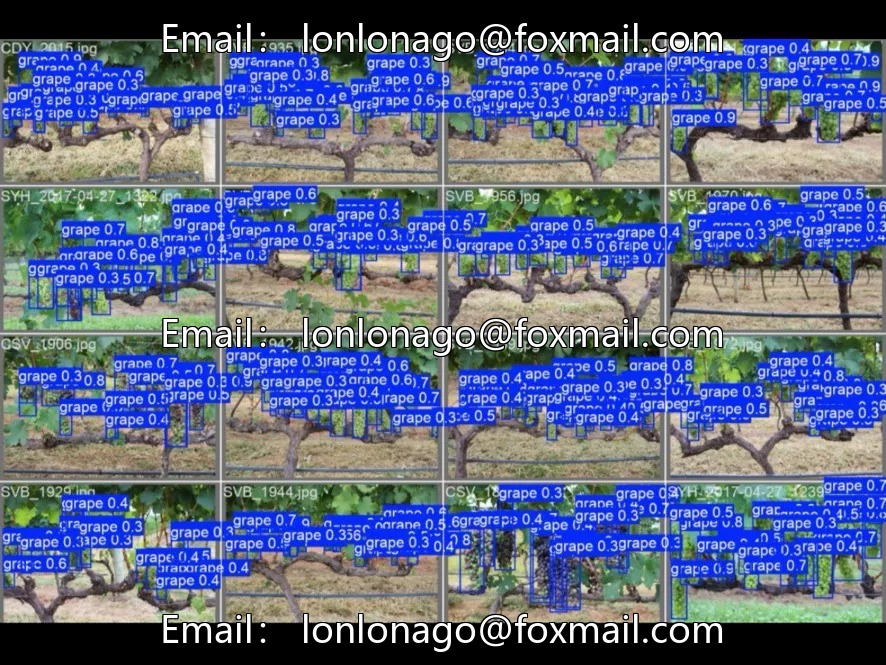
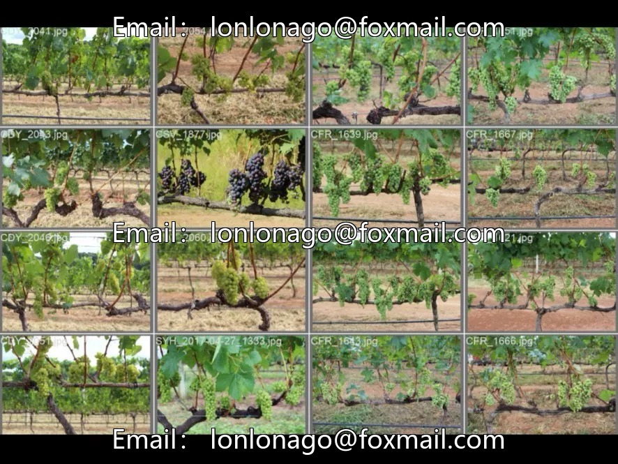
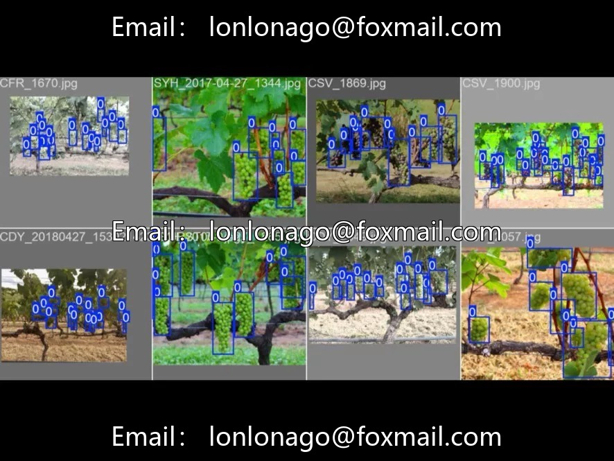
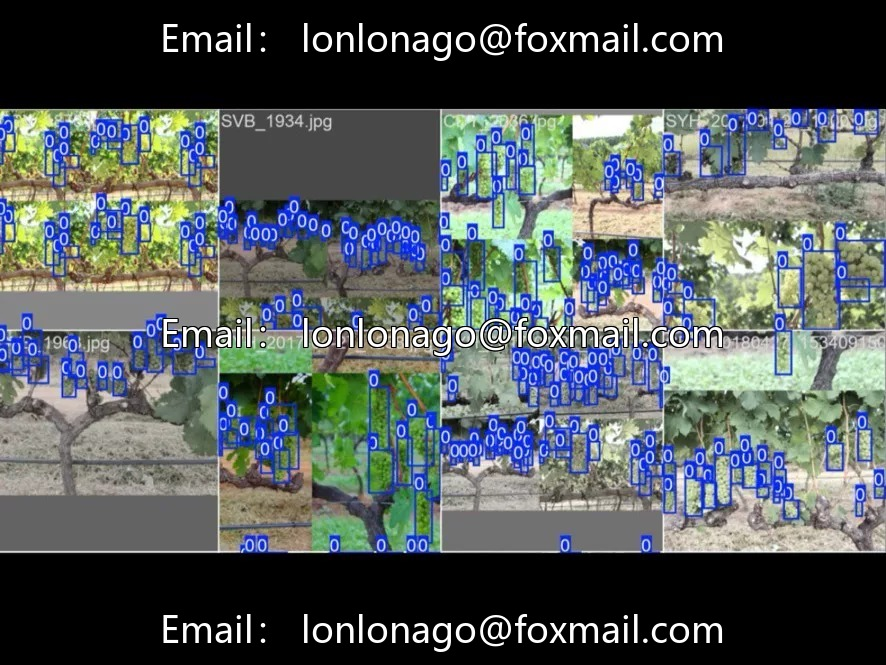

# YOLO+ drone grape detection and counting system, orchard yield estimation tool. Grape-specific

## Body

YOLO+ drone grape detection and counting system, orchard yield estimation tool. Grape-specific detection model (grape_model directory), including dataset, training weights, operational scripts, supports real-time YOLO detection of orchard images by drones, automatically counts the number of fruits, suitable for smart agriculture management, orchard digitalization, precision agriculture projects.

Project description is brief, specific details such as the number of images and categories need to be viewed after downloading. Project latest code submission 2 years ago, using YOLOv5/v8 early versions, take note of environmental compatibility.

Virtual materials, once sold, are non-refundable.
Interested friends, click "I want" to proceed.

## Images

## Payment

Here is a pay link on Stripe ( https://buy.stripe.com/3cs8yP7sY87d0vu9AB ). Please contact me lonlonago@foxmail.com after funding $89, and I will send you a complete data files , thank you!

